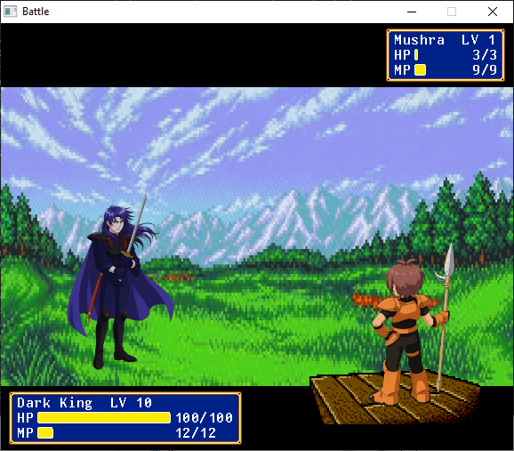
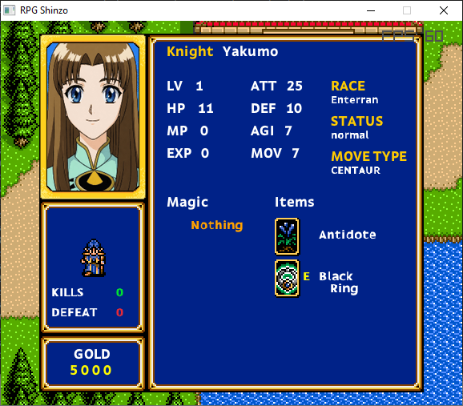

# 🎮 RPG Shinzo Maker

Собственный движок для создания тактических RPG в духе Shining Force.  
Включает **игровой движок на Ruby (Raylib)** и **единое приложение-редактор (Maker) на C# (Avalonia UI)**.

---

## 🧩 Компоненты

### 1. Игровой движок (Ruby + Raylib)

| Требование        | Значение                     |
|-------------------|------------------------------|
| Язык              | Ruby 4.0.2 (проверено, но подходят 3.2+) |
| Графика / Ввод    | Raylib 5.5+ (через гем `raylib-bindings 0.7.18`) |
| Платформа         | Windows / Linux / macOS      |
| Аудио             | Raylib Audio (MP3)           |
| Данные карт       | JSON                         |

**Возможности:**  
- Ходьба по карте с анимациями  
- Двухслойные карты (земля + декорации)  
- **Два независимых слоя коллизий (основной и перекрывающий)**  
- Система меню (Статус, Магия, Предметы, События)  
- Окно просмотра магии с иконками заклинаний  
- **Боевые сцены** с тактической расстановкой и анимациями  
- Динамические панели HP/MP с цветовыми слоями  

---

### 2. Maker — Единый редактор (C# + Avalonia UI)

Ранее проект использовал набор разрозненных утилит на C + SDL2. **Теперь они полностью заменены единым кроссплатформенным приложением на C#.** Это центральный узел проекта.

| Требование        | Значение                     |
|-------------------|------------------------------|
| Язык              | C# 14 (.NET 10)              |
| UI-фреймворк      | Avalonia UI 12.1.3           |
| IDE               | JetBrains Rider / Visual Studio |
| Платформа         | Windows / Linux / macOS      |

**Реализованные модули (вкладки):**
- **Map Editor** – редактирование карт (два слоя тайлов, два слоя коллизий, Undo/Redo).
- **Event Editor** – настройка NPC, диалогов, варпов, триггеров.
- **Map Importer** – автоматическая нарезка цельных картинок на тайлсеты.
- **Database Editor** – управление базой данных (Герои, Классы, Предметы, Магия).

**В планах (в разработке):**
- **Battle Editor** – редактор тактических битв.
- **Scene Editor** – редактор боевых анимаций и сцен.

---

## 🖱️ Управление зумом в редакторе карт

1. Наведи курсор на **область карты** (не на левую панель с тайлами).  
2. Зажми клавишу **Ctrl** (левый или правый).  
3. Крути колёсико мыши:  
   - **От себя** — приближение (зум увеличивается до 2.0×)  
   - **На себя** — отдаление (зум уменьшается до 0.5×)

Текущий масштаб отображается плавно, без рывков.

---

## 📁 Структура проекта

~~~text
RPG-Shinzo/
├── assets/                 # Тайлсеты, иконки, спрайты, звуки, шрифты
├── data/
│   ├── actors/             # Данные персонажей, классов, инвентаря
│   ├── maps/               # JSON-файлы карт
│   ├── items/              # Предметы
│   ├── spells/             # Заклинания
│   └── tile_types/         # Типы тайлов для каждого тайлсета
├── lib/                    # Ruby-скрипты игры (движок)
├── Maker/                  # Исходный код редактора (C# / Avalonia)
│   ├── src/                # Проекты решения (Core, Desktop)
│   └── RpgShinzoMaker.slnx # Файл решения
│   └── RpgShinzoMaker.Desktop.exe  # <-- ГОТОВЫЙ ФАЙЛ для запуска
├── game.rb                 # Точка входа игры
└── README.md
~~~

---

## 🔧 Установка и сборка

### Игровой движок (Ruby)

~~~bash
gem install raylib-bindings
ruby game.rb
~~~

**Сборка в .exe (Windows):**
~~~bash
gem install ocran -v 1.4.3

# С окном консоли:
ocran game.rb

# Без консоли (оконное приложение):
ocran game.rb --windows --output Shinzo.exe
~~~

### Редактор Maker (C#)

Для запуска `RpgShinzoMaker.Desktop.exe` (или сборки из исходников) на компьютере должен быть установлен **.NET 10 Runtime (или SDK)**.

~~~bash
cd Maker
dotnet build
dotnet run --project src/RpgShinzoMaker.Desktop
~~~

---

## 📋 Зависимости

**Для игры:**
- Ruby 3.2+ / 4.0.2
- Raylib 5.5+ (с биндингом `raylib-bindings 0.7.18`)
- `ocran` (для упаковки Ruby-приложений в .exe)

**Для редактора Maker:**
- .NET 10 SDK / Runtime
- Avalonia UI (устанавливается автоматически через NuGet при сборке)